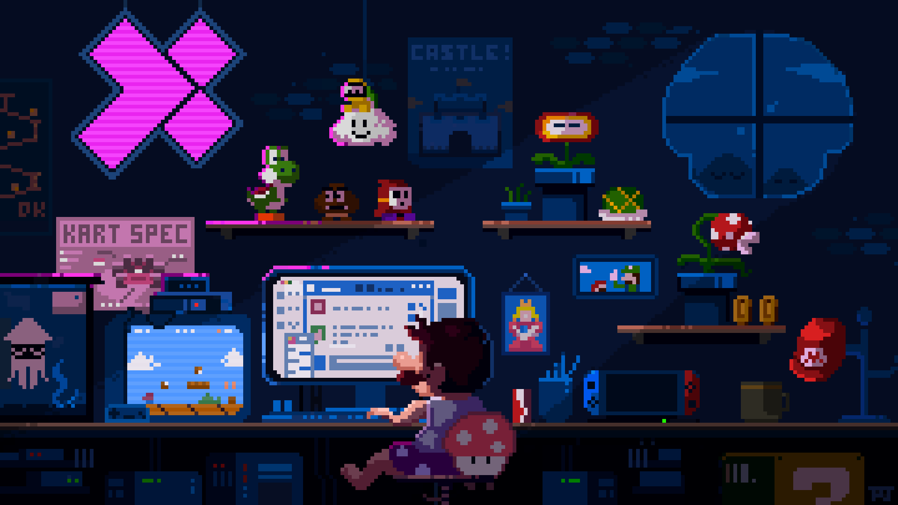

<div align="center">
  
</div>

<div align="center">

# Hi, I'm Sriz 👋

**Developer Relations · Web3 & AI Engineer · Community Builder**

I build developer tools on Web3 and AI, and I help developers adopt them through content, workshops and hackathons.<br>
Kolkata Lead @ TigerGraph · Stellar & Midnight ambassador · B.Tech CSE @ GCELT (2027)

<a href="https://www.linkedin.com/in/srizdebnath"></a>
<a href="https://x.com/Srizdebnath"></a>
<a href="https://rebrand.ly/sriz"></a>
<a href="mailto:srizd449@gmail.com"></a>

</div>

---

## 🤝 Community & DevRel

- **Kolkata Lead, TigerGraph** – run the city's developer chapter: meetups, workshops and hackathon content
- **Lead organiser, host and speaker – TigerGraph GraphRAG Inference Hackathon** (national level), plus the TigerGraph Content Bounty program
- **Ambassador** for Stellar (IND), Midnight Network (Aliit), OSEN, Quant.io, Miro and Metaspace · **Co-Lead** at theBuilder base
- **10+ events hosted** in 2026: MetaMask Community Builder Night Kolkata (V1 & V2), Introduction to Midnight, Global Bitcoin Pizza Party Kolkata, Road to Devcon w/ ETH Kolkata, Team1 Builder Connect and more
- **Judge / mentor** at QuantCraft 2026 (Galgotias University) and Zyro 2026 (KGEC)
- **Content:** a 15-day "Learning Web3" thread series on X, and content bounties for 8+ ecosystems (Arbitrum, Monad, Midnight, TigerGraph…)
- **54+ hackathons since mid-2025** – Top 0.25% at Hack4Health IIIT Delhi (11/4500+), Winner at Hacktropica S2, 1st Runner-Up at XIBIT 2026 and Frosthacks S2

## 🛠️ Featured Projects

<div align="center">

| 🐍 [PyBitrum](https://github.com/Srizdebnath/PyBitrum) | 🦀 [Prometheus](https://github.com/Srizdebnath/Prometheus) |
| :--- | :--- |
| **Write smart contracts in Python.** A 4-stage AST pipeline compiles to both Solidity (^0.8.26) and Vyper (^0.4.0), with a 100/100 pass rate on a 100-contract test suite. Browser IDE with Monaco, GitHub OAuth and one-click MetaMask deploy to Arbitrum Sepolia; autonomous agent wallets and swarms. <br><br>    | **UCI chess engine in Rust – 43M nodes/sec at depth 18.** Magic bitboards, principal variation search, null-move pruning, late-move reductions and a 64 MB transposition table. Opening book built from 517K master games. <br><br>   |

| 🛡️ [voria](https://github.com/Srizdebnath/voria) | 🌌 [stellar-nexus](https://github.com/Srizdebnath/stellar-nexus) |
| :--- | :--- |
| **AI-powered security, reliability and bug-fixing CLI.** A fast Rust CLI drives a persistent Python AI engine over NDJSON IPC: 52 checks across security, reliability, performance and code quality, streaming multi-LLM output, and SARIF export for GitHub Security. Published on npm. <br><br>    | **Decentralised compute marketplace on Soroban.** Developers monetise smart-contract applets that users run straight from the browser. A fine-tuned Llama 3.3 generates gas-optimised Soroban/Rust code; gasless transactions via Stellar fee bumps. 35+ testnet users. <br><br>    |

| 🧠 [mindflare.ai](https://github.com/Srizdebnath/mindflare.ai) | ☁️ [InFoundry](https://github.com/Srizdebnath/InFoundry) |
| :--- | :--- |
| **AI SaaS for RAG pipelines and agents.** Auto-RAG knowledge bases that ingest PDFs, websites and GitHub repos; a dashboard to orchestrate multiple agents; TypeScript SDK and CLI; one-command WhatsApp deployment. <br><br>    | **Self-adaptive cloud architect and SRE agent.** A fine-tuned Oumi model inspects code and telemetry, proposes IaC and CI changes, and opens PRs through a Kestra pipeline, with human approval. Full MCP server; multi-cloud Terraform with cost projection. <br><br>    |

</div>

**Also:** [LegacyLift](https://github.com/Srizdebnath/LegacyLift) (Gemini agent that modernises whole codebases and opens PRs) · [Telos](https://github.com/Srizdebnath/Telos) (intent-oriented language with Z3 compile-time verification, self-hosting) · [graphrag-protocol](https://github.com/Srizdebnath/graphrag-protocol) · [THE_VARIDIAN_PROTOCOL](https://github.com/Srizdebnath/THE_VARIDIAN_PROTOCOL)

## 🌍 Open-Source Contributions

**Merged:**

- [ethereum/py_ecc #170](https://github.com/ethereum/py_ecc/pull/170) – BLS: reject public keys and signatures of the wrong length
- [OpenZeppelin/openzeppelin-contracts #6876](https://github.com/OpenZeppelin/openzeppelin-contracts/pull/6876) – clean up changesets already released in 5.7.0
- [OpenZeppelin/openzeppelin-confidential-contracts #473](https://github.com/OpenZeppelin/openzeppelin-confidential-contracts/pull/473) – return `success` from `BatcherConfidential._join`, saving FHE operations

**Open PRs** to [ethereum/kohaku](https://github.com/ethereum/kohaku), [huggingface/transformers](https://github.com/huggingface/transformers), [Consensys/gnark](https://github.com/Consensys/gnark), [worldcoin/semaphore-rs](https://github.com/worldcoin/semaphore-rs), [iden3](https://github.com/iden3), [zk-kit](https://github.com/zk-kit) and [noir-lang/noir_bigcurve](https://github.com/noir-lang/noir_bigcurve).

## ⚡ Stack

<div align="center">


</div>

## 📈 Activity

<div align="center">
  
</div>

<div align="center">

```python
class SrizDebnath:
    role = "Developer Relations · Web3 & AI Engineer"
    community = ["TigerGraph Kolkata", "Stellar", "Midnight", "ETH Kolkata"]
    building = ["dev tools", "AI agents", "smart-contract compilers"]

    def day(self):
        return self.build() + self.teach() + self.ship()
```


</div>
